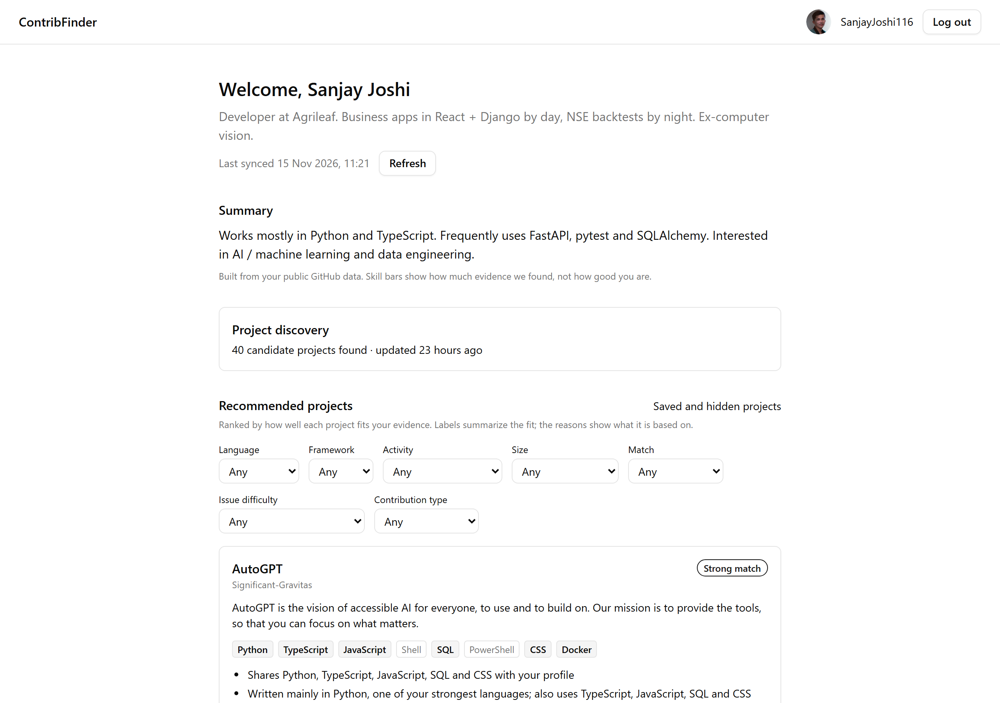
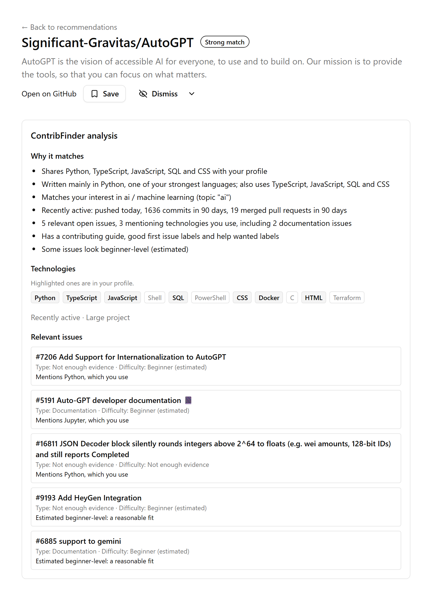
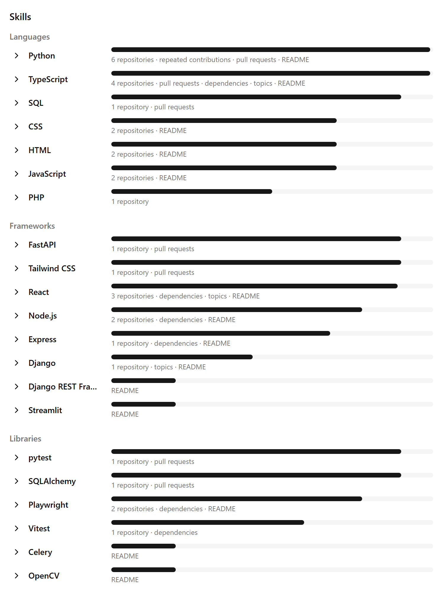
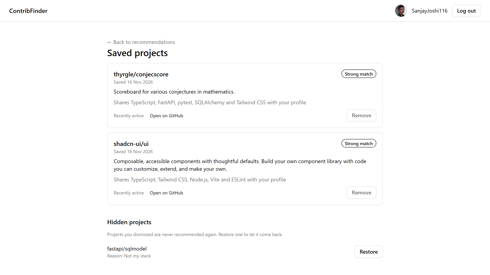

# ContribFinder

Finds open-source repositories and issues that match a developer's demonstrated skills and
interests. It builds an evidence-backed profile from GitHub and explains every recommendation.

**Version 0.12.80** (feedback ids and signal enum; MVP+). After signing in with
GitHub, your public profile, README, repositories, dependencies and contributions are synced in
the background and turned into an evidence-backed profile: skills (with the evidence behind each),
interests and languages. From that profile ContribFinder finds and analyzes candidate projects,
then ranks them with deterministic, versioned scoring and shows each recommendation with a match
label (Strong, Good, Partial) and the reasons behind it, never a percentage. You can save or
dismiss projects (optionally saying why: not my stack, too big, inactive, already know it),
refresh everything, and delete your GitHub data or your account at any time
(see the in-app privacy page). Each recommendation also lists the open issues that fit you, with
their contribution type and an estimated difficulty (or "Not enough evidence"), and what was
found at the project's root to help you set it up (CI, tests, a dev container, Docker Compose;
shown, never scored). Ranking changes
are measured offline on a hand-judged benchmark before they count as improvements (see
"Evaluating a ranking change"). Semantic matching comes later.

- Stack: Django + DRF + Celery + PostgreSQL (+ Redis), React 19 + TypeScript + Vite.
- What's shipped and planned: [`features.txt`](features.txt). Release notes: [`CHANGELOG.md`](CHANGELOG.md).
  Unplanned ideas (gap analysis): [`ideas.md`](ideas.md).
- Requirements: `Software Requirements Specification - 2.txt` (authoritative) and `- 1.txt`,
  kept outside the repository (gitignored); `CLAUDE.md` and `openspec/specs/` carry what was
  built from them.
- License: [MIT](LICENSE). Security reports: [`SECURITY.md`](SECURITY.md). Contributing:
  [`CONTRIBUTING.md`](CONTRIBUTING.md).
- Engineering guide and roadmap: [`CLAUDE.md`](CLAUDE.md). Specs: `openspec/specs/`; archived
  changes: `openspec/changes/archive/`.

## Screenshots

Taken from v0.12.76; the interface is being redesigned, so newer versions may look different.

**Dashboard:** the evidence-backed profile summary, then recommended projects with filters,
match labels and reasons.



**Recommendation detail:** why a project matches, its technologies, and open issues that fit,
each with a contribution type and an estimated difficulty.



| Skills and their evidence | Saved and hidden projects |
|---|---|
|  |  |

## 1. Register a GitHub OAuth App

GitHub → Settings → Developer settings → OAuth Apps → **New OAuth App**

| Field | Value |
|---|---|
| Homepage URL | `http://localhost:5173` |
| Authorization callback URL | `http://localhost:5173/api/v1/auth/github/callback` |

Copy the **Client ID** and generate a **Client secret**. ContribFinder requests no OAuth scopes;
it reads public data only.

## 2a. Run locally (no Docker)

Requires Python 3.12+, [uv](https://docs.astral.sh/uv/) (`python -m pip install uv` works too; it
doesn't need to be on PATH, and you can set `UV_BIN` to point at it),
Node 24, a local PostgreSQL and, for background jobs, Redis. On Windows, Redis runs inside WSL
(Ubuntu); `npm start` starts it for you. Without Redis the cache is in-process and background
tasks run inline, so GitHub syncs block the request.

Create the database once. `psql` prompts for the `postgres` password:

```powershell
& "C:\Program Files\PostgreSQL\18\bin\psql.exe" -U postgres -h localhost -c "CREATE ROLE contribfinder LOGIN PASSWORD 'contribfinder' CREATEDB;" -c "CREATE DATABASE contribfinder OWNER contribfinder;"
```

`CREATEDB` lets the test suite create its own `test_contribfinder` database.

Install Redis in WSL once (runs as root, so no sudo password is needed):

```powershell
wsl -d Ubuntu -u root -- apt-get install -y redis-server
```

ContribFinder uses Redis database 1 (`REDIS_URL=redis://localhost:6379/1`), so it doesn't touch
anything else stored in that Redis.

Then:

```bash
npm install        # root: installs the dev runner
npm run setup      # creates .env with generated secrets, installs deps, runs migrations
```

Add `GITHUB_CLIENT_ID` and `GITHUB_CLIENT_SECRET` from step 1 to `.env`, then:

```bash
npm start          # WSL Redis + Django :8000 + Celery worker + Celery beat + Vite :5173 (proxies /api)
npm run stop       # stop the stack from another prompt (Ctrl+C in its own console also works)
```

Each runner records its process id in the gitignored `.run/` folder (the Redis runner also records
the `wsl.exe` keep-alive that holds WSL awake). `npm run stop` stops only recorded processes that
still run the recorded program, plus this checkout's Django, Celery and Vite (matched by the
repository path), so another project or a second checkout keeps running; stale records are
discarded. Closing the console window stops the stack too, keep-alive included. Each checkout
keeps its own Celery beat schedule file (named after a hash of the repository path). Stacks
started before 0.12.9 have no records: stop them once with the old `npm run stop` before upgrading.
If the keep-alive session ends while the stack runs, the Redis runner starts a new one and logs the
exit code; after 3 restarts within 5 minutes it gives up and the stack stops.

`.gitattributes` checks text files out with LF on every OS (since 0.12.11), so the format checks
pass on Windows. A Windows checkout made earlier still has CRLF working files: refresh them once,
on a tree with no uncommitted changes (Git Bash):

```bash
git ls-files -z | xargs -0 rm -f && git checkout -- .
```

Celery beat runs the periodic repository jobs: it marks candidate repositories stale and
refreshes them in the background with the OAuth app's client credentials (never a user's
token). Beat also recovers jobs: a job whose worker died (no heartbeat for
`SYNC_STALE_AFTER_SECONDS`) or whose queued task was lost is requeued once, and a job that used
every `SYNC_MAX_ATTEMPTS` ends as `worker_lost`. Without `REDIS_URL` there is no worker or
beat, so those jobs do not run; syncs then run inline in the request and a GitHub error that
would be retried (rate limit, 5xx) fails the job instead. A background refresh that fails
without a retry records the error on the repository and waits `REPO_REFRESH_RETRY_MINUTES`
(60) before the next attempt.

If Redis goes down while the app runs, API reads keep working: sessions live in PostgreSQL, and
request throttling counts in each process's memory for `THROTTLE_CACHE_BACKOFF_SECONDS` (30)
after a Redis error, then tries Redis again. A worker that loses the GitHub response cache keeps
going: requests go out without their ETag condition, and the cache is skipped for
`GITHUB_CACHE_BACKOFF_SECONDS` (30). GitHub responses larger than `GITHUB_ETAG_MAX_BYTES`
(256 KiB) are never cached, so big READMEs do not grow Redis, which also holds the broker.

Open http://localhost:5173. API health: http://localhost:5173/api/v1/health/.

Django management commands work from the root without uv on PATH:

```bash
npm run manage -- migrate
npm run manage -- reanalyze_profiles   # rebuild profiles from stored data (no GitHub calls)
```

Profile scoring is configurable in `.env` (`EVIDENCE_WEIGHTS` and friends, see `.env.example`).
Run `reanalyze_profiles` after changing it. Repository discovery budgets, filters, staleness and
activity thresholds (`DISCOVERY_*`, `REPO_*`, `ACTIVITY_THRESHOLDS`) are configured the same way.
Every search query runs once per star band (`DISCOVERY_STAR_BANDS`, default `DISCOVERY_MIN_STARS`–999
and 1000+), so the pool holds smaller projects as well as the most popular ones;
`DISCOVERY_MAX_QUERIES` counts these requests (default 20). Repositories without a detected language
are rejected as `not_code`; suspected lists (named `awesome-*` or tagged with a
`DISCOVERY_EXCLUDED_TOPICS` topic) are analyzed once and are `not_code` unless they declare
manifest dependencies.
A completed sync or re-analysis starts a discovery run automatically, and a completed discovery
starts a recommendation generation. Ranking limits and sizes (`RECOMMENDATION_*`,
`RECOMMENDATIONS_TOP_N`, `REPO_SIZE_THRESHOLDS`) and the view de-duplication window
(`FEEDBACK_VIEW_DEDUP_MINUTES`) are in `.env.example` too, as are the issue fetch budget and
difficulty thresholds (`ISSUES_MAX_PAGES`, `ISSUE_*`). When a repository has more open issues
than that budget, one page per entry label (`ISSUES_ENTRY_LABELS`, default `good first issue`
and `help wanted`) is fetched as well, so its older entry issues are not cut off. Scoring weights and issue matching
parameters live in the active `ScoringConfig` (Django admin); `v2-deterministic` is active.

## Evaluating a ranking change

Ranking changes are measured offline on a fixed benchmark, `apps/backend/evaluation/benchmark-v1.json`:
persona developers with hand-judged candidate repositories (0 not relevant, 1 relevant, 2 highly
relevant). No GitHub calls, no stored data changes.

```bash
npm run manage -- evaluate_ranking --config v1-deterministic --config v2-deterministic
npm run manage -- evaluate_ranking --config v2-deterministic --config-file my-config.json --require-improvement
```

It prints Precision@5, Precision@10, Recall@10, MRR and NDCG@10 per configuration (the first is
the baseline, deltas in parentheses) and every developer's top 10 with judgments (`?` = unjudged).
`--config-file` takes `{"weights": ..., "params": ...}` for a configuration not stored yet;
`--json OUT` writes the full report. A configuration counts as an **improvement** only when its
NDCG@10 is higher than the baseline's and no other metric drops by more than `--tolerance`
(0.01); `--require-improvement` exits non-zero otherwise.

With few developers a difference can be one developer's ranking moving, so every configuration
after the baseline also gets a **paired bootstrap** block: per metric, the difference from the
baseline, its 95% interval over developers (10,000 resamples of the developers, with
replacement) and the share of resamples in which it is not better. A `*` marks an interval that
excludes 0. An unmarked difference is inconclusive at this sample size, not zero; with a handful
of developers the interval is a floor on the uncertainty, not a guarantee. The figures are
information only: the improvement rule, `--require-improvement`, activation and `baselines.json`
do not read them. The seed is fixed, so reruns print the same numbers; `--resamples N` and
`--seed N` change them, and `--json` writes them under `comparisons`. On `benchmark-v1`, v2's
NDCG@10 +0.0195 has the interval [-0.0023, +0.0501] (not better in 8.2% of resamples).

### Feedback report

```bash
npm run manage -- feedback_report --since 90
```

Reads the stored feedback events (saves, dismissals, GitHub clicks, views) and reports them per
scoring configuration version and rank bucket (1-5, 6-10, 11-20, 21+): the count of each action,
the number of users, and the **positive share**, saved and opened (repository or issue) out of
those plus dismissed. There is no "shown" event, so it is a share of what users decided, not a
click-through rate. Each configuration also gets a **position-adjusted** share, its bucket shares
weighted by one bucket mix common to every configuration in the report, so acting on
higher-ranked items does not by itself make a configuration look better. Groups with fewer than
`--minimum` (10) decisive actions show counts but no share. `--config` picks versions, `--json OUT`
writes the report (put it in the gitignored `reports/` folder: `--json ../../reports/feedback.json`,
since commands run in `apps/backend`). Aggregates only (no user, repository or recommendation
ids); it changes nothing and never affects ranking.

Each configuration also gets one row per **match label** (Strong, Good, Partial) and a
**calibration** verdict: `ordered` when no label's share is below a lower label's, `not ordered
(strong below good)` naming the first pair out of order, or `not enough data` when fewer than two
labels reach the minimum. Label shares are raw, not adjusted for rank, because that is how users
meet the label. Read the verdict with the user counts: a few heavy users can flip it. Changing
the label bands is a ranking change and goes through `evaluate_ranking`.

Each configuration with dismissals also gets a **dismiss reasons** line, for example
`dismiss reasons: inactive 6, not_my_stack 3, none 4` (`none` = dismissed without a reason;
JSON `dismiss_reasons`). Reasons change no share and never affect ranking: "inactive" points at
the activity signal, "not my stack" at the technology signals, for a later ranking change to
check on the benchmark. Dismissals without a recommendation snapshot get their own reasons line
under "Without a recommendation snapshot" (JSON `unattributed_dismiss_reasons`).

Holdout datasets (`evaluation/holdout-v1.json`, `holdout-v2.json`, four other personas each)
guard against tuning to the benchmark: pass one with `--dataset`. A new configuration replaces the
active one only when it is an improvement over every stored configuration on `benchmark-v1` and
does not regress on the current acceptance holdout by more than the tolerance; a holdout never
chooses between candidates. Once a search has recorded results on a holdout, it cannot accept a
later search's candidate: both existing holdouts are used, so the next search adds `holdout-v3`.

Configurations can opt into these scoring options (no stored configuration uses them yet):
`params.issues.difficulty_fit_mode: "weighted"` (difficulty fit grows with the number and quality
of fitting issues instead of one fitting issue scoring 1.0) and `params.relevance_scaling: true`
(activity, openness and the issue signals count in proportion to how relevant the project is),
plus their own minimum score: `params.min_score` with `params.min_score_basis` `"score"` (the
whole score) or `"relevance"` (the skill, language, framework and interest part only). Without
them, `RECOMMENDATION_MIN_SCORE` applies. `evaluate_ranking --min-score` overrides every
configuration's minimum and says so in the output.

`evaluation/baselines.json` records the stored configurations' metrics per dataset (with the
top N they were computed at), and a test fails when they move. After an intended ranking change,
run `npm run manage -- evaluate_ranking --write-baseline` and commit the file with the change.
Without `--dataset` it rewrites `benchmark-v1`, every other recorded dataset whose file exists,
and the selection benchmark. It merges: `--config v2-deterministic` replaces v2's entries and
keeps v1's. A different `--top-n` must cover every configuration recorded for the dataset, and
`--min-score` is refused (the test recomputes each configuration at its own minimum score).

To make a configuration active, use the activation command. It is the only way: the Django admin
shows the command on each configuration's page but never runs the benchmark comparison itself.

```bash
npm run manage -- activate_scoring_config v3-example
npm run manage -- activate_scoring_config v1-deterministic --force --reason "rollback after incident"
```

It refuses an unknown or invalid configuration, and one that is not an improvement over the
active one on the selection benchmark (it prints the failed metrics). `--force --reason` makes a
deliberate exception, such as a rollback; it also works when the benchmark or the active
configuration is unusable (audited as not compared). The verdict uses the pinned baseline
minimum score and top N, so a local `.env` cannot change it. If another activation lands while
one is being judged, it fails: run it again. Every activation is audited with both versions,
whether the rule was overridden, the reason and the failed metrics. Check the acceptance holdout yourself before activating: the
command does not read it. Recommendations regenerate under the new configuration on the next
freshness run.

To add a configuration, seed it inactive and activate it with the command; a seed never makes a
configuration active (only the `v1-deterministic` and `v2-deterministic` seeds did, and a test
fails if another one does):

1. Add a data migration in `apps/backend/recommendations/migrations/` with frozen copies of the
   weights, parameters and description (never import them from `services/`). Its forward step
   calls `_seeding.store_inactive(apps, version=..., description=..., weights=..., params=...)`
   and its reverse step `_seeding.remove_unused(apps, version=...)` (import the module with
   `from . import _seeding`). Re-applying it never changes a stored version, and reversing it
   deletes the version only while it is inactive and produced no recommendations.
2. Evaluate it against the active configuration (`evaluate_ranking --config <active> --config
   <new>`) and on a fresh acceptance holdout, then record its baseline (`--write-baseline`).
3. Activate it with `activate_scoring_config <new>`.

### Discovery yield report

```bash
npm run manage -- discovery_report --since 30
```

Shows how discovery's search budget was spent, from finished discovery runs: per strategy
(language, skill, interest, topic search), per star band and per strategy and band, the
requests (and how many GitHub refused), the results, the rejections per reason (`no_license`,
`archived`, …), the candidates recorded, results per request and the share of results recorded.
Use it before changing queries, shares, bands or the budget: such a change alters what users
are recommended. Runs from before 0.12.25 recorded no per-query yield and are only counted. A
repository found by two queries counts for both. `--json OUT` writes it (put it in the gitignored
`reports/`: `--json ../../reports/discovery.json`). Aggregates only: no user, job, repository or
query text; it changes nothing.

### Judging real developers

The personas were invented and judged by the same author who designed the ranking, so the
benchmark also takes real developers judged by a person who knows them. Export only accounts whose
owner agreed. Exports and sheets go in the repository's `judging/` folder, which is gitignored
(they are anonymized, but they describe a real person's skills). `npm run manage` runs in
`apps/backend`, so relative paths start there: `../../judging` below is that folder (created if
missing).

1. **Bigger pool.** The local `.env` caps discovery at 10 candidates. For the export, set
   `DISCOVERY_MAX_POOL=40` and `DISCOVERY_MAX_ANALYSES_PER_RUN=40`, run `npm start`, sign in as the
   developer and press **Refresh**; wait until the stage line shows recommendations are done. This
   uses that account's GitHub API budget.
2. **Export** (no GitHub calls; no username, email, GitHub id or token; neutral id):
   ```bash
   npm run manage -- export_benchmark_developer --user-id 2 --as real-a --out ../../judging/real-a.json
   ```
3. **Judge blind.** Write a sheet and grade it in a spreadsheet (2 highly relevant, 1 relevant,
   0 not relevant, blank = not judged; try to grade every row). The sheet shows each repository's
   description, languages, topics, contribution files, activity and open issue count, in
   alphabetical order, and nothing the ranking computed:
   ```bash
   npm run manage -- benchmark_sheet --export ../../judging/real-a.json --out ../../judging/real-a.csv
   ```
4. **Import** the grades (validated; nothing is written on an error). `#` guide lines count only
   above the header; fully blank rows are ignored; a repeated repository or a grade without a
   repository fails naming the row:
   ```bash
   npm run manage -- import_judgments --export ../../judging/real-a.json --sheet ../../judging/real-a.csv
   ```
5. **Build** `benchmark-v2` from the personas and the judged exports (add `--on-conflict first`
   if two exports describe the same repository differently, e.g. exported on different days):
   ```bash
   npm run manage -- build_benchmark --name benchmark-v2 --out evaluation/benchmark-v2.json \
     --input evaluation/benchmark-v1.json --input ../../judging/real-a.json
   ```

Once `benchmark-v2.json` holds a judged real developer, it is the **selection benchmark**:
`evaluate_ranking` uses it by default and reports the persona and real developers' means
separately. Committing it is the judge's decision; if it stays local, the baseline test skips it.

## Your data

The dashboard's "Your data" section and the public `/privacy` page cover what is stored.
**Delete GitHub data** removes everything derived from GitHub (profile, skills, recommendations,
saved and hidden projects, feedback, job history) and keeps your account, so you can sync again.
**Disconnect GitHub** deletes the stored credential and the same data at once, and revokes
ContribFinder's authorization on GitHub in the background (a worker job, retried if GitHub is
unreachable; the request never waits for GitHub). **Delete account** does both and removes the
account. None of these touch your GitHub account itself. Expired sign-in sessions are removed
daily.

## 2b. Run with Docker

```bash
cp .env.example .env    # or reuse the .env from `npm run setup`
docker compose up --build
```

Compose runs its own Postgres (host port 5433) and Redis, and overrides `DATABASE_URL` and
`REDIS_URL` with container hostnames, so the same `.env` works for both modes. If you copied
`.env.example`, fill in `DJANGO_SECRET_KEY` and `TOKEN_ENCRYPTION_KEYS` yourself (commands
are in the file).

The backend (http://127.0.0.1:8000) and the frontend (http://localhost:5173) are published on
the loopback interface only. Redis is not published on the host, so it never collides with the
WSL Redis that `npm start` uses, and Postgres stays on host port 5433. `DJANGO_SETTINGS_MODULE`
comes from `.env`, not from your shell. Vite polls for file changes in the container (bind
mounts from Windows send no file events). The frontend's `node_modules` live in an anonymous
volume, so after a frontend dependency change rebuild with
`docker compose up --build --renew-anon-volumes`.

## Deploying behind a proxy

Production settings (`config.settings.production`) refuse to start the web server, Celery
worker or beat when a system check reports an error (for example empty `TOKEN_ENCRYPTION_KEYS`).
Set `NUM_PROXIES` to the number of proxies you control in front of Django (usually 1 for a
TLS-terminating load balancer). With `0`, forwarded headers are ignored: every client behind the
proxy shares one throttle bucket and HTTPS detection fails, so the SSL redirect loops (system
check `core.W002` warns about this). `/api/v1/health/` is never throttled or redirected, so
probes can use plain HTTP.

### Content Security Policy

Every Django response carries a `Content-Security-Policy` header: API responses (JSON) allow
loading nothing, and the admin and error pages allow resources from their own origin only
(`CONTENT_SECURITY_POLICY_API` and `CONTENT_SECURITY_POLICY_HTML` in
`config/settings/base.py`; system check `core.E060` refuses an empty one). The built SPA
(`npm run build`) declares its own policy in a `<meta>` tag in `dist/index.html`
(`apps/frontend/csp.config.ts`); the Vite dev server does not, because hot reload needs an
inline script. Whatever serves `dist/` in production should send the same policy as a
`Content-Security-Policy` header with `frame-ancestors 'none'` added, which a meta tag cannot
set.

## Secrets

`TOKEN_ENCRYPTION_KEYS` encrypts stored GitHub tokens. To rotate, put a new key first
(`new,old`); old tokens still decrypt. If every key is lost, users just sign in again.
Never commit `.env`. Report vulnerabilities privately ([`SECURITY.md`](SECURITY.md)).

## Tests

`uv run pytest` in `apps/backend` (uses local PostgreSQL) and `npm test` in `apps/frontend`.
Of your `.env`, pytest uses only `DATABASE_URL` (`DJANGO_READ_DOTENV=DATABASE_URL` in the test
settings), so local results match CI's; an explicit environment variable still wins.
`npm run test:scripts` at the root tests the dev runners (process matching, port waits, beat
schedule name, version check) with Node's built-in test runner; CI runs them on Linux and on
Windows (`scripts-windows`). CI installs exactly what the lockfiles record (`uv sync --locked`,
`npm ci`): a `pyproject.toml` change without `uv lock` fails it. The OpenAPI type generator
(`npm run api:sync`) has its own locked npm tree in `apps/frontend/tools/api-types`
(TypeScript 5; the app is on 6), installed by `npm run setup`.
`tests/test_migration_round_trip.py` unapplies every app's migrations and applies them again
(about 18 s): give every `RunPython` / `RunSQL` a reverse (`noop` when there is nothing to undo),
or it fails naming the migration.
All commands are in `CLAUDE.md` §6.

### Dependency audit

`npm run audit:deps` at the root checks every lockfile for known vulnerabilities: the backend's
`uv.lock` with `pip-audit` (run through `uv`, nothing installed into the project) and every npm
lockfile (root, `apps/frontend`, and the API type generator's `apps/frontend/tools/api-types`;
`NPM_TREES` in `scripts/env.mjs`) with `npm audit`. It reads only the locked versions. Any Python
advisory and any high or critical npm advisory fails it (exit 1); low and moderate npm advisories
are listed only, and a Python package pip-audit could not check fails too. Every locked
package is audited on every platform (environment markers are ignored). Exit 2 means an audit
could not run. CI runs it on every pull request and push
to `main`, every Monday and on demand (`.github/workflows/audit.yml`), so a new advisory turns
it red without a commit.

Fix a finding by upgrading (`uv lock --upgrade-package NAME` in `apps/backend`;
`npm audit fix --package-lock-only` in the folder named), then run the tests. If your npm config
has `allow-remote=none`, the frontend needs `--allow-remote=all` for that one command (a
Tailwind WebAssembly package is fetched by URL). When no fixed version exists yet, accept the
advisory in `audit-accepted.json`:

```json
[
  {
    "ecosystem": "npm",
    "id": "GHSA-xxxx-xxxx-xxxx",
    "package": "example",
    "reason": "Build-time only; no fixed version yet.",
    "accepted_on": "2026-10-28"
  }
]
```

`ecosystem` is `pypi` or `npm`; `id` is the advisory id the audit prints (a PyPI alias works
too). Every field is required and unknown fields are refused. The audit lists entries that no
longer match anything: remove them.

### End-to-end tests

Playwright runs the main flows (sign-in start, onboarding, dashboard, save, dismiss and undo,
relevant issues, session end, data deletion) in Chromium against the real backend and
PostgreSQL. Nothing calls GitHub: sign-in uses sessions created by a seed command that only
`config.settings.e2e` installs.

- One-time: `npx playwright install chromium` in `apps/frontend`. The `contribfinder` role
  needs `CREATEDB`, as for `pytest`: the seed creates the `contribfinder_e2e` database.
- `npm run e2e` in `apps/frontend`. It re-seeds the database on every run, starts Django on
  `127.0.0.1:8001`, builds the SPA into `dist-e2e/` (gitignored; your `dist/` is left alone) and
  serves that build with `vite preview` on `5174`, so it runs alongside `npm start`. The tests
  see what ships, Content Security Policy included: any policy violation the page reports fails
  the test.
- `E2E_DEV_SERVER=1 npm run e2e` uses the Vite dev server instead (no build, no policy): quicker
  while writing a spec. CI never sets it.
- Retries are set by `RETRIES` in `playwright.config.ts` (the seed builds one copy of each
  data-changing user per attempt). CLI `--retries` and `--repeat-each` are not supported for
  those tests: they fail at sign-in saying so. A second run inside one `--ui` session is not
  supported either and cannot be detected: those tests fail on data the first run changed.
  Run `npm run e2e` (or restart `--ui`) again for a fresh seed.
- Of your `.env` only `DATABASE_URL` is used (`DJANGO_READ_DOTENV=0` for Django), so local runs
  see the same settings as CI. The SPA build does read `apps/frontend/.env*` files (Vite), so
  keep `VITE_*` overrides out of them when comparing with CI, which has none.

## Known limitations

- **Docker Compose is not verified** from a fresh `.env` (K-2); the local setup above is the
  tested path.
- **No semantic matching yet.** Ranking is deterministic, from skills, languages, topics and
  activity; embeddings come later (Phase 6).
- **Docs-style repositories** with a code language and no list topic (for example
  `system-design-primer`) can pass the "not code" filter (K-4).
- **Issue recommendations are not benchmarked**; only repository ranking is measured (K-3).
- **Public data only:** private repositories and private contributions are never read.

Verified findings and their fix batches: [`Bug_Backlog.md`](Bug_Backlog.md). Release notes:
[`CHANGELOG.md`](CHANGELOG.md).

## Versioning

`VERSION` is the single source of truth. Keep `package.json`, `apps/frontend/package.json` and
`apps/backend/pyproject.toml` in sync; `npm run check:version` (also run in CI) verifies it.
Before the MVP, each completed roadmap phase bumps the minor version; fix releases bump the patch
version.
